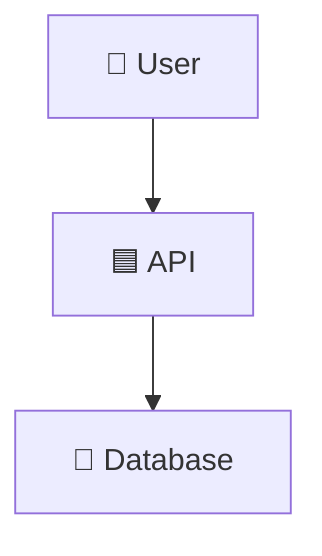
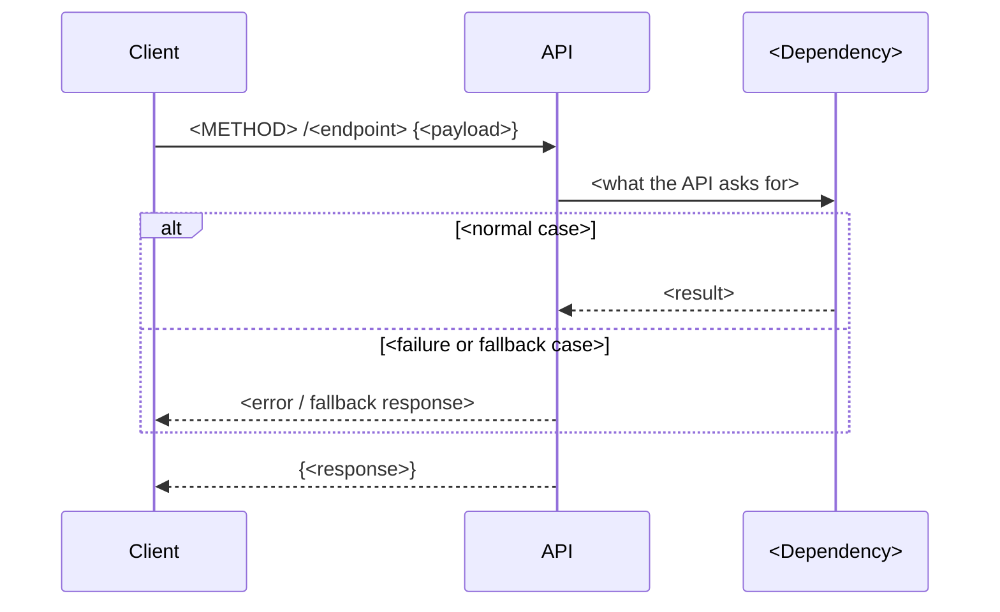

<!--
README TEMPLATE. This file becomes your project's README: fill it in right after
creating a project from project-starter. (How the starter itself works: docs/STARTER.md.)
Rules:
  - Describe only what is ACTUALLY built. Mark planned work as ⬜, never ✅.
  - Delete sections that don't apply, and keep the Table of Contents in sync.
  - Replace every <PLACEHOLDER>. Search for "<" before publishing.
-->

> 🧰 **This repo is `project-starter`**, a template for new projects. How to use it: [docs/STARTER.md](docs/STARTER.md). *(Delete this line in your new project.)*

# <EMOJI> <Project Name> — <short subtitle>

> <One sentence: what it does, for whom, and the one thing that makes it interesting.>


<!-- More badges: https://shields.io/badges -->

---

## 📌 Table of Contents

<details open>
<summary><b>Click to expand / collapse navigation</b></summary>

- [🔎 Overview](#-overview)
- [📸 Demo](#-demo)
- [🧠 What is <Concept>?](#-what-is-concept)
- [🎯 What This Project Does](#-what-this-project-does)
- [🏗️ Architecture](#️-architecture)
- [🛠️ Technology Stack](#️-technology-stack)
- [📁 Project Structure](#-project-structure)
- [✨ Key Features](#-key-features)
- [🧩 Design Decisions](#-design-decisions)
- [⚡ Quick Start](#-quick-start)
- [⚙️ Setup & Installation](#️-setup--installation)
- [🚀 Walkthrough](#-walkthrough)
- [🎥 Video Demonstration](#-video-demonstration)
- [🧩 Troubleshooting](#-troubleshooting)
- [📌 Assignment Coverage](#-assignment-coverage)
- [👨‍💻 Author](#-author)

</details>

---

## 🔎 Overview

<2–4 sentences: what the system does end to end.>

1. **<Step 1>** — <what happens>
2. **<Step 2>** — <what happens>
3. **<Step 3>** — <what happens>

---

## 📸 Demo

> <One line describing what the screenshot shows.>


---

## 🧠 What is <Concept>?

| Term / Question | Answer | Implemented by |
|-----------------|--------|----------------|
| **<Concept>** | <Plain-English explanation> | <Component> |

<Why this matters: what goes wrong without it.>

---

## 🎯 What This Project Does

```mermaid
flowchart LR
    A[<Input>] --> B[<Step>]
    B --> C[<Step>]
    C --> D[<Result>]
```



---

## 🏗️ Architecture



### Component Breakdown

| Component | Role |
|-----------|------|
| **<Component>** | <What it does and why it exists> |

### Request Flow

<!-- One request, step by step, in time order. Add a participant per component. -->



---

## 🛠️ Technology Stack

| Layer | Technology | Function |
|-------|------------|----------|
| **Application** | Python 3.12, FastAPI | <...> |
| **Testing** | pytest | Automated tests |
| **Quality** | ruff, pre-commit, GitHub Actions | Lint, format and tests on every push |
| **Container** | Docker | Image build |

---

## 📁 Project Structure

```text
<repo>/
│
├── src/app/
│   ├── main.py                   # <...>
│   └── config.py                 # Settings from env / .env
│
├── tests/
│   └── test_health.py
│
├── docs/decisions.md             # Design decision records
├── .github/workflows/ci.yml      # Lint → test → Docker build
├── Dockerfile
├── Makefile
└── README.md
```

---

## ✨ Key Features

- ✅ **<Feature>:** <one line>
- 🛡️ **<Failure handling>:** <one line>
- 🔐 **<Security / config>:** <one line>

---

## 🧩 Design Decisions

Full records in [docs/decisions.md](docs/decisions.md).

| Decision | Why |
|----------|-----|
| **<Decision>** | <Reason, and what was traded off> |

---

## ⚡ Quick Start

> Run the app locally in a few commands.

```bash
cp .env.example .env
make install
make check
make run          # http://localhost:8000/docs
```

---

## ⚙️ Setup & Installation

### Prerequisites

| Tool | Purpose | Install |
|------|---------|---------|
| Python 3.12+ | Run the app and tests | [python.org](https://www.python.org/downloads/) |
| uv | Dependencies | `brew install uv` |
| Docker Desktop | Containers | [Download](https://www.docker.com/products/docker-desktop/) |

### 1. Run with Docker

```bash
make docker
```

### 2. <Deploy / other environment>

```bash
<commands>
```

---

## 🚀 Walkthrough

| Step | Component | What happens |
|------|-----------|--------------|
| 1 | **<Component>** | <...> |

### Demonstrating <Key Behaviour>

1. <Action>
2. <Action>
3. <Expected result>

---

## 🎥 Video Demonstration

| # | Section |
|---|---------|
| 1 | The problem |
| 2 | Architecture |
| 3 | Live demo |
| 4 | Failure case |
| 5 | Design decisions |

<!-- Add the video link once published: [▶ Watch the demo](<VIDEO_URL>) -->

---

## 🧩 Troubleshooting

<!-- Add real problems you hit while building. These are the most useful entries. -->

<details>
<summary><b>❌ <Error message></b></summary>

<Cause, then the fix:>
```bash
<command>
```
</details>

---

## 📌 Assignment Coverage

<!-- Delete this section if the project is not an assignment. -->

| Requirement | Implementation | Status |
|-------------|---------------|:------:|
| **<Requirement>** | <Where / how> | ✅ |
| **<Planned item>** | Planned | ⬜ |

---

## 👨‍💻 Author

**Vijay Rangvani**
*Backend & AI Engineering Learner | Healthcare IT*

| | |
|--|--|
| 🐙 GitHub | [github.com/vijayrangvani](https://github.com/vijayrangvani) |
| 💼 LinkedIn | [linkedin.com/in/vijayrangvani](https://www.linkedin.com/in/vijayrangvani/) |

**Focus Areas:** <Python · FastAPI · ...>
