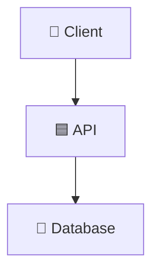

<!--
README TEMPLATE. Copy to README.md when you start a new project, then fill it in.
Rules:
  - Describe only what is ACTUALLY built. Mark planned work as ⬜, never ✅.
  - Delete sections that don't apply (e.g. Assignment Coverage for non-assignments).
  - Keep the Table of Contents in sync with the headings you keep.
  - Replace every <PLACEHOLDER>. Search for "<" before publishing.
-->

# <EMOJI> <Project Name>: <short subtitle>

> <One sentence: what it does, for whom, and the one thing that makes it interesting.>

[](https://github.com/<USER>/<REPO>/actions/workflows/ci.yml)


<!-- More badges: https://shields.io/badges (Docker, Kubernetes, PostgreSQL, Redis, ...) -->

---

## 📌 Table of Contents

<details open>
<summary><b>Click to expand / collapse navigation</b></summary>

- [🔎 Overview](#-overview)
- [📸 Demo](#-demo)
- [❓ Problem](#-problem)
- [🏗️ Architecture](#️-architecture)
- [🛠️ Technology Stack](#️-technology-stack)
- [📁 Project Structure](#-project-structure)
- [✨ Key Features](#-key-features)
- [🧭 Design Decisions](#-design-decisions)
- [⚡ Quick Start](#-quick-start)
- [⚙️ Setup & Installation](#️-setup--installation)
- [🧪 Testing](#-testing)
- [🎥 YouTube Demonstration](#-youtube-demonstration)
- [🔧 Troubleshooting](#-troubleshooting)
- [⚠️ Known Limitations](#️-known-limitations)
- [🚧 What I'd Do Next](#-what-id-do-next)
- [📌 Assignment Coverage](#-assignment-coverage)
- [👨‍💻 Author](#-author)

</details>

---

## 🔎 Overview

<2–4 sentences: what the system does end to end.>

- <Key capability 1>
- <Key capability 2>
- <What happens when something fails>

---

## 📸 Demo

<!-- Recruiters look here first. Add a GIF or screenshot: assets/demo.gif -->


---

## ❓ Problem

<What real problem does this solve? Who has it? Why do simple approaches fall short?
Optionally list the engineering questions the project answers.>

---

## 🏗️ Architecture



### Component Breakdown

| Component | Role |
|-----------|------|
| **<Component>** | <What it does and why it exists> |

<!-- Optional: a sequence diagram of one request (mermaid sequenceDiagram) -->

---

## 🛠️ Technology Stack

| Layer | Technology | Function |
|-------|------------|----------|
| **API** | Python 3.12, FastAPI | <...> |
| **Testing** | pytest | <...> |
| **Quality** | ruff, pre-commit, GitHub Actions | Lint, format, tests on every push |

---

## 📁 Project Structure

```text
<repo>/
│
├── src/app/
│   ├── main.py            # <...>
│   └── config.py          # Settings from env / .env
│
├── tests/
│   └── test_health.py
│
├── docs/decisions.md      # Design decisions and trade-offs
├── Dockerfile
├── Makefile
└── pyproject.toml
```

---

## ✨ Key Features

- ✅ **<Feature>:** <one line>
- 🛡️ **<Failure handling>:** <one line>
- 🧪 **<Testing approach>:** <one line>

---

## 🧭 Design Decisions

Full records in [docs/decisions.md](docs/decisions.md).

| Decision | Why |
|----------|-----|
| **<Decision>** | <Reason, and what you traded off> |

---

## ⚡ Quick Start

> <Fastest way to see it working.>

```bash
cp .env.example .env
make install
make run          # http://localhost:8000/docs
```

---

## ⚙️ Setup & Installation

### Prerequisites

| Tool | Purpose | Install |
|------|---------|---------|
| Python 3.12+ | Run the app and tests | [python.org](https://www.python.org/downloads/) |
| uv | Dependencies | `brew install uv` |
| Docker Desktop | Containers | [Download](https://www.docker.com/products/docker-desktop/) |

### 1. Run locally

```bash
<commands>
```

### 2. Run with Docker / Compose / Kubernetes

```bash
<commands>
```

---

## 🧪 Testing

```bash
make check     # lint + format check + tests
```

| Test | Proves |
|------|--------|
| `<test_name>` | <What behaviour it guarantees> |

**Verified manually:** <the live checks you ran, e.g. "deleted a pod, history survived">

---

## 🎥 YouTube Demonstration

| # | Section |
|---|---------|
| 1 | The problem |
| 2 | Architecture |
| 3 | Live demo |
| 4 | Failure case (what happens when X goes down) |
| 5 | Design decisions and limitations |

<!-- Add the video link once published: [▶ Watch on YouTube](https://youtu.be/...) -->

---

## 🔧 Troubleshooting

<!-- Add real problems you hit while building. These are the most useful entries. -->

<details>
<summary><b>❌ <Error message></b></summary>

<Cause, then the fix:>
```bash
<command>
```
</details>

---

## ⚠️ Known Limitations

<!-- Honest limits show engineering judgement. -->
- **<Limitation>:** <impact>

---

## 🚧 What I'd Do Next

- <Next improvement, in priority order>

---

## 📌 Assignment Coverage

<!-- Delete this section if the project is not an assignment. -->

| Requirement | Implementation | Status |
|-------------|---------------|:------:|
| **<Requirement>** | <Where / how> | ✅ |
| **<Planned item>** | Planned | ⬜ |

---

## Not building an API?

<!-- Delete this section once the README is for a real project. -->
This starter defaults to FastAPI. For a CLI tool, data pipeline or batch job, keep everything else and change 4 things:

1. **Dependencies:** `uv remove fastapi uvicorn` (keep `pydantic-settings`), then `uv add` what you need. Commit `pyproject.toml` and `uv.lock` together.
2. **Entry point:** replace `src/app/main.py` with a plain `run() -> int` function and `if __name__ == "__main__": raise SystemExit(run())`.
3. **Test:** replace `tests/test_health.py` with `assert run() == 0`.
4. **Run + Docker:** in the `Makefile`, change `run` to `uv run python -m app.main`. Delete the `Dockerfile` and the CI `docker build` step if nothing is deployed; otherwise set `CMD ["python", "-m", "app.main"]` and drop `EXPOSE 8000`.

Then run `make check`: it should pass before your first real commit.

---

## 👨‍💻 Author

**Vijay Rangvani**
*Backend & AI Engineering Learner | Healthcare IT*

| | |
|--|--|
| 🐙 GitHub | [github.com/vijayrangvani](https://github.com/vijayrangvani) |
| 💼 LinkedIn | [linkedin.com/in/vijayrangvani](https://www.linkedin.com/in/vijayrangvani/) |

**Focus Areas:** <Python · FastAPI · ...>
